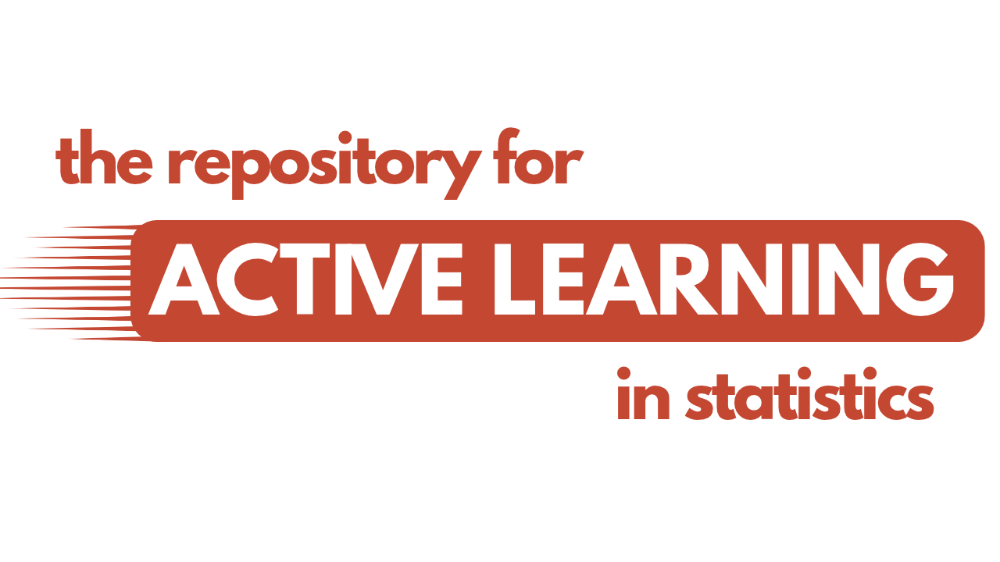

{fig-align="center" width="750"}

A repository containing activities I've used to incorporate active learning into statistics and data science lectures.

Link: <https://grcetmpk.github.io/active-learning-repository/>
