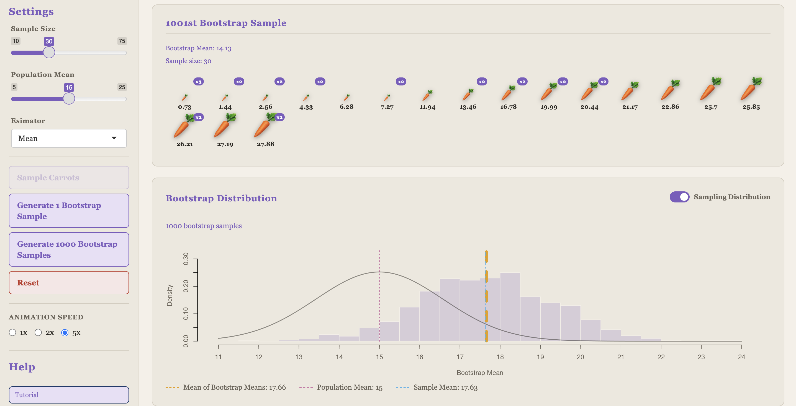

{fig-align="center"}

An RShiny app developed to demonstrate the basics of the sampling and bootstrap distributions at a preliminary level. This app was developed using Generative AI tools. **This app is currently being redeveloped with the help of a Graduate Academic Assistant and the Flexible Learning Group**.

Shiny App: <https://grcetmpk.shinyapps.io/bootstrap_dsci100/>

GitHub Repository: <https://github.com/grcetmpk/Bootstrapping-applet>
