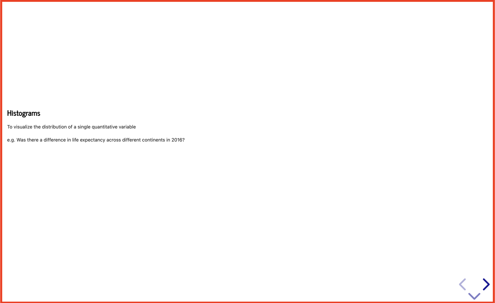
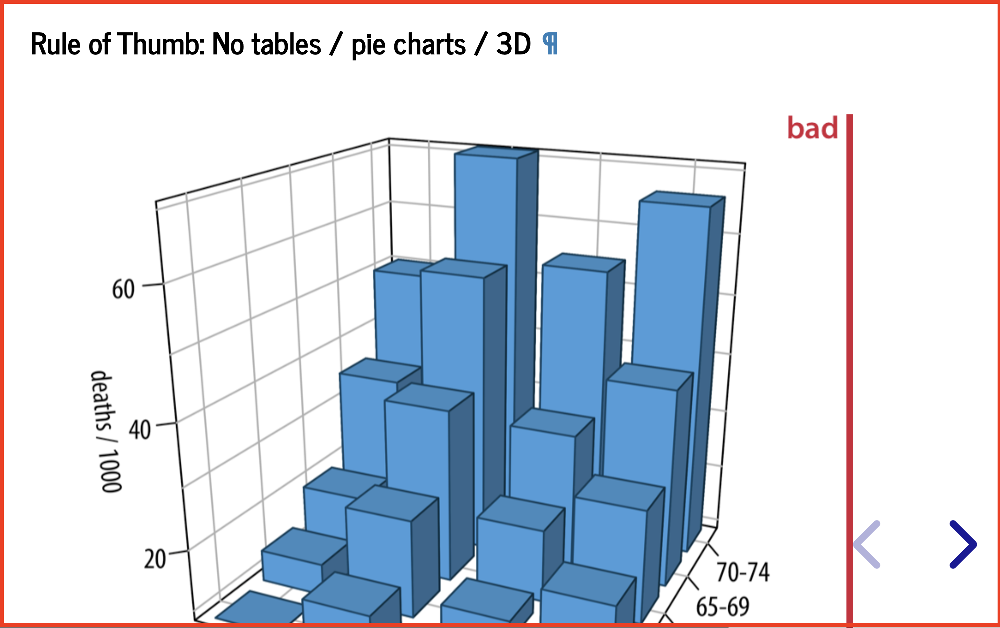
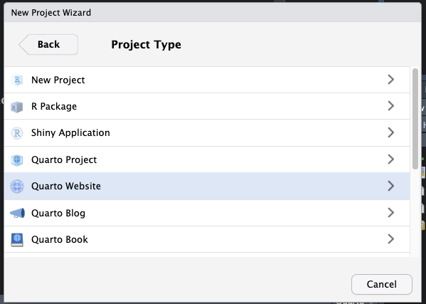
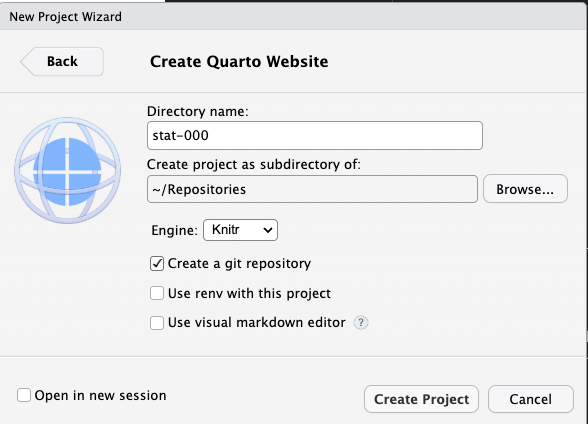
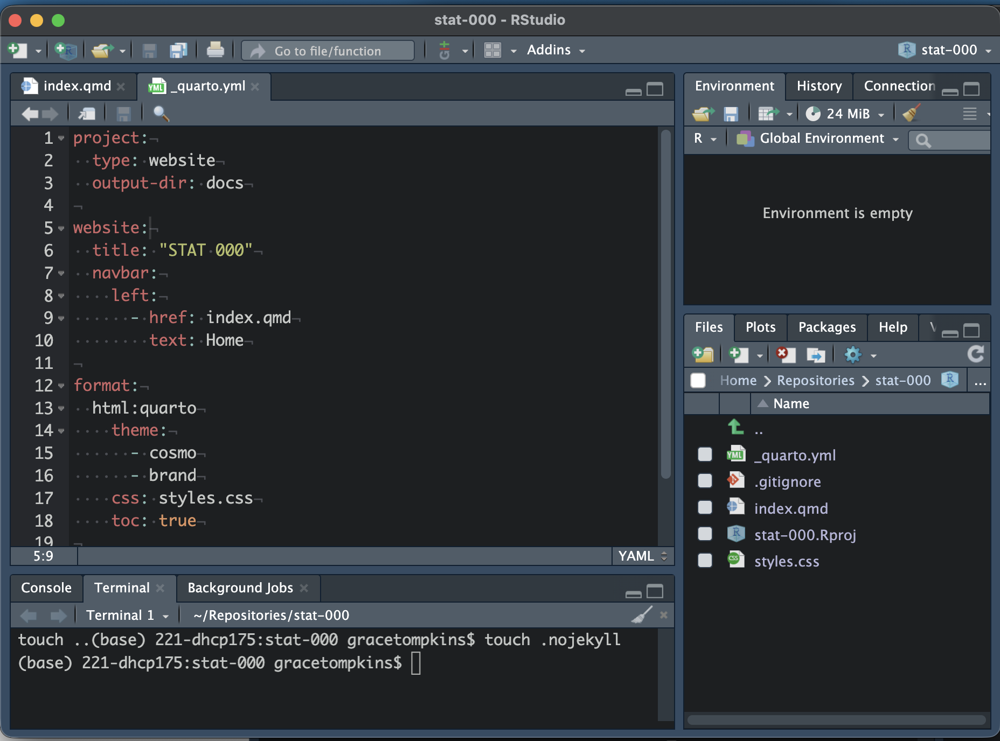
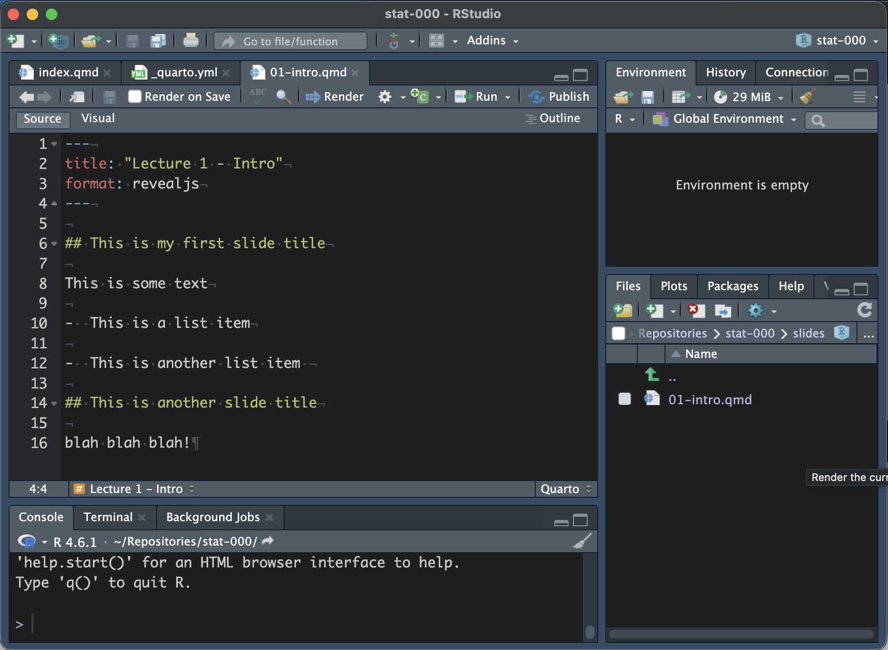
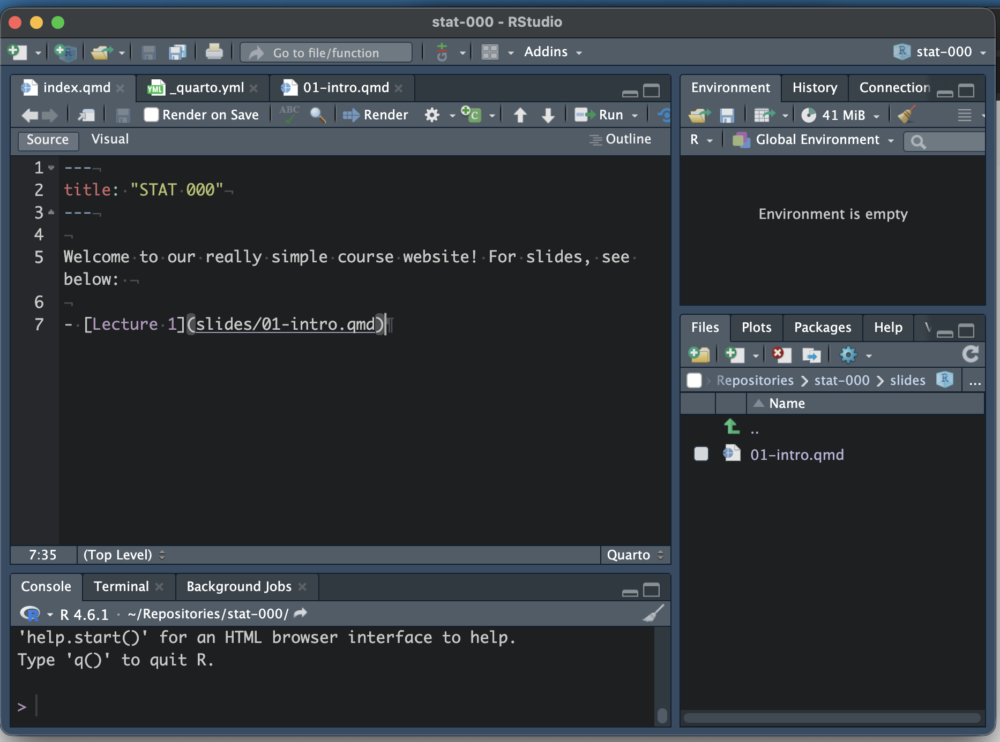
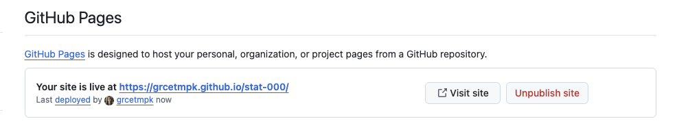
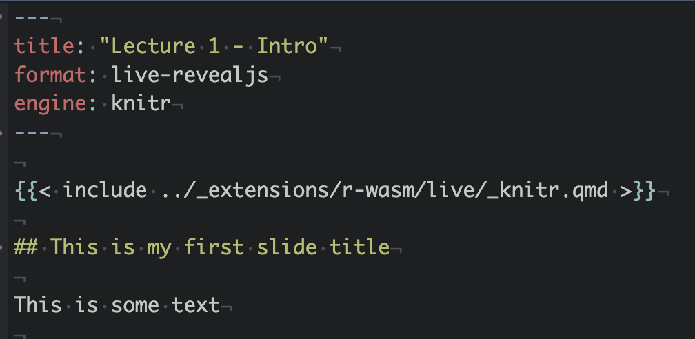

# Motivation

## Motivation

-   My first course assigned at UBC was DSCI 100

-   Slides were built using RISE/JupyterHub

    -   Allowed instructors to run code in the slides (cool! 😃)

    -   Connected with GitHub (great for collaboration across 5+
        instructors 😃)

## Motivation

-   My first course assigned at UBC was DSCI 100

-   Slides were built using RISE/JupyterHub

    -   Students could not code in the slides ☹️

    -   Couldn't easily control text and image size ☹️

    -   Generally a pain to edit and present with ☹️

    -   Terrible (in my opinion) user interface ☹️

## Motivation

Text size at 100% zoom

{fig-align="center"}

## Motivation

Images after zooming to an appropriate size for the text

{fig-align="center"}

## Motivation

Quarto (a next-generation version of RMarkdown launched by Posit in
2022) provided an opportunity to remove many of these pain points.

{fig-align="center" width="100"}

-   Similar syntax to RMarkdown/RISE

-   Options for custom css styling

-   Easy webpage dev with GitHub pages

-   Extensions for slides, live coding (both end users)

# Example

## Quarto Slides in STAT 545

[STAT545 Lecture Slides on Data
Visualization](https://ubc-stat.github.io/stat545/webpages/slides/lec4a_datavis_slides.html#/title-slide)

Features:

-   Live code blocks with scaffolding

-   Scrollable slides

-   Hidden code for generating data sets (`gapminder_2026`)

-   Tip boxes, links, stylized text, images

# Demo

## Prerequisites

Let's build a minimal, reproducible course website with a slide deck!

If you'd like to follow along, you'll need:

-   RStudio (or Positron) with
    [Quarto](https://quarto.org/docs/get-started/) installed

-   a GitHub account

## Step 1: Create a Quarto project

-   Go to File \> New Project \> New Directory \> Quarto Website

::: {#fig-quartoproj layout-ncol="2"}




Quarto Project Set Up
:::

## Step 2: Set up the website {.scrollable .nostretch}

-   **Before doing anything, remove the Jekyll template by running
    `touch .nojekyll` in the terminal**

## Step 2: Set up the website {.scrollable .nostretch}

Pages:

-   `index.qmd` is the homepage.

    -   Do not rename, but you can edit the contents!

-   `about.qmd is another page`.

    -   You can rename/delete/edit this (I will delete)

## Step 2: Set up the website {.scrollable .nostretch}

Pages:

-   `_quarto.yml` is used to organize and set up the website.

    -   Do not rename.

    -   I am adding `output-dir: docs` to the project section



## Step 3: Add some slides {.scrollable .nostretch}

-   Create a folder called `slides` and add `01-intro.qmd`

-   Update the output format to `format: revealjs`

-   Update the title

-   Write some slides with level two headers (`##`)

Hit the render button to see what it looks like!



## Step 4: Link the slides to the homepage {.scrollable .nostretch}

-   Link the slides to your homepage with a relative file path



Render website to see what it looks like, and ensure your link works!

## Step 5: Host on GitHub Pages {.scrollable .nostretch}

-   Run `quarto render` in the **terminal** to render entire site

-   Create a repo (I prefer the `usethis` package with `use_git()` and
    `use_github()`)

-   On your GitHub repository, go to Settings \> Pages. Set the branch
    as `main` and the folder as `docs` and click save.

    -   Wait, refresh, and visit your live site!



## Step 6: Install webr and Quarto live {.scrollable .nostretch}

-   In the terminal, run `quarto add r-wasm/quarto-live`

-   Trust the extension and allow changes by running `Y` twice. You can
    view documentation if you'd like.

Now, a `_extensions` folder will appear with `r-wasm` and `live` folders
nested within it.

## Step 7: Set up webr and Quarto live {.scrollable .nostretch}

In your slide file (`01-intro.qmd`):

-   Change the output format to `live-revealjs` and add `engine: knitr`
    in the preamble.
-   Add `` directly
    under the preamble

{fig-align="center"}

## Step 8: Create executable code cells

-   Add the following code to the bottom of your `01-intro.qmd` file:

```
quarto render

git add . git commit -m "adding executable cells to lec01" git push
origin main

```         

Wait for GH Pages to sync and refresh your site.

# Final Thoughts

## Reflections

-   My students loved the Quarto slides in DSCI 100 and the work of converting them from RISE to Quarto was relatively minimal.

-   I use Quarto for most course content, and it saved me from the Great Canvas Attack of 2026

-   Quarto also can use Python code chunks! (plus... Positron, the next gen RStudio allows you to code in both R and Python)

-   Quarto 2 is coming soon! It will have more collaborative features and will be re-written in rust so that rendering is nearly instant.

## Recommendations

-   Provide students with scaffolding of code (do you want to type 10 lines of ggplot code every time you plot something?)

-   Provide datasets in the slides with
```

format: 

  live-revealjs: 
  
    resources: - data/gapminder.csv

```         

-   Set slides to be scrollable by default OR text to be smaller with
```

format: 

  live-revealjs: 
  
    scrollable: true 
    
    smaller: true

```         

## Recommendations

-   You can change the owner of the repo to an organization (i.e. UBC-STAT or UBC-DSCI) under the "Danger Zone" in the repository settings

-   (revealjs only  - I think??) Create hidden blocks with

``` html
---
title: Lecture 10
format: 
  revealjs: default
  pdf: default
---

::: {.content-hidden when-format="revealjs"}

[your solution which is only shown when rendered to pdf]

:::
```

-   Control which code chunks are persistent, static, editable,
    read-only, or automatically run
    (<https://r-wasm.github.io/quarto-live/getting_started/editor.html>)

-   Add tests for automatic feedback!
    (<https://r-wasm.github.io/quarto-live/exercises/grading.html>)

## Wrap-up {.nostretch}

-   This exact [repository](https://github.com/grcetmpk/stat-000) builds
    the fake course website <https://grcetmpk.github.io/stat-000/>

-   All content (including slides and a YouTube video) can be found on
    [my website](https://grcetmpk.github.io/workshops/tlsds-2026/) under
    "Workshops"

